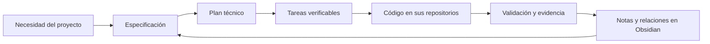

# DevGuardian — SDD, Spec Kit y Obsidian

[](https://github.com/LuisMI2005-sudo/DevGuardian-SDD-Obsidian/actions/workflows/docs.yml)

**Grupo:** Six seven  
**Integrantes:** Eduardo Quinteros, Sebhastian Campero y Luis Miguel Gonzales.

Repositorio documental independiente para la revisión docente de **Specification-Driven Development (SDD)** y del segundo cerebro en **Obsidian**. Reúne las especificaciones, planes, tareas, constituciones, arquitectura, modelo de datos, diagramas Mermaid, grafos y evidencia de DevGuardian. El código de la aplicación permanece en sus repositorios propios.

**Versión integrada vigente:** [commits finales y recibos de integración](VERSION_FINAL.md). Los estados anteriores de PRs abiertos se conservan como cortes históricos.

## Recorrido recomendado para el docente

| Qué revisar | Documento o carpeta |
|---|---|
| Recorrido de la versión publicada y commits Live | [Protocolo](specs/009-deployed-e2e/spec.md), [acta con IDs y capturas](specs/009-deployed-e2e/ACTA.md) |
| Revisión del equipo | [Acta de constituciones y Obsidian; confirmación de los tres integrantes](specs/011-team-review/ACTA.md) |
| Constitución y principios | [Constitución del backend](specs/constitution.md) y [frontend](frontend/specs/constitution.md) |
| Especificación, plan y tareas SDD | [Adopción SDD](specs/001-sdd-foundation/spec.md), [plan](specs/001-sdd-foundation/plan.md), [tareas](specs/001-sdd-foundation/tasks.md) |
| Separación de este repositorio | [Especificación](specs/003-documentation-repository/spec.md), [plan](specs/003-documentation-repository/plan.md), [tareas](specs/003-documentation-repository/tasks.md) |
| Evidencia de la entrega independiente | [Validación y publicación comprobada](specs/003-documentation-repository/validation.md) |
| Spec Kit operativo | [.specify/](.specify/), [habilidades](.agents/skills/) y [plantillas visibles](specs/templates/) |
| Segundo cerebro conceptual | [Inicio del conocimiento](specs/segundo-cerebro/00-Segundo-cerebro.md) |
| Módulos de la aplicación | [Mapa de módulos](specs/segundo-cerebro/arquitectura/00-Arquitectura-modulos.md) |
| Arquitectura futura | [Microservicios, multitenancy y microfrontends](specs/segundo-cerebro/arquitectura-objetivo/00-Arquitectura-Objetivo.md) |
| Perfil local implementado | [Arquitectura y límites de la migración](specs/002-platform-migration/architecture.md) |
| Modelo de datos | [Modelo relacional inicial](specs/001-sdd-foundation/data-model.md) |
| Auditoría, negocio y marketing | [Informe integral](specs/segundo-cerebro/auditoria-integral/00-Informe-Integral.md) |
| Especificaciones del frontend | [Índice SDD del frontend](frontend/specs/README.md) |
| Evidencia y limitaciones | [Validación local de la migración](specs/002-platform-migration/validation.md) y [procedencia](PROCEDENCIA.md) |
| Reparación aislada, validación local y CI | [Alcance](specs/004-safe-repair-deployment/spec.md), [plan](specs/004-safe-repair-deployment/plan.md) y [evidencia](specs/004-safe-repair-deployment/validation.md) |
| Consolidación con recuperación de proyectos | [Merges, PRs y pruebas de integración](specs/004-safe-repair-deployment/consolidation.md) |
| Backlog y trazabilidad final | [51 HU e issues](specs/005-final-traceability/backlog.md), [matriz de evidencia](specs/005-final-traceability/traceability.md), [especificación](specs/005-final-traceability/spec.md), [plan](specs/005-final-traceability/plan.md) y [validación](specs/005-final-traceability/validation.md) |
| Dos incrementos del proyecto final | [INC-01 Organizaciones y accesos / INC-02 Espacio modular](specs/006-final-increments/spec.md), [antes y después](specs/006-final-increments/evidence.md) y [guion de demo](specs/006-final-increments/demo.md) |
| Aceptación ejecutable de los dos incrementos | [Checklist con 12 criterios, resultados y acta](CHECKLIST_ACEPTACION_INCREMENTOS.md); seguimiento en QA-004/QA-005 y HU-37 |
| Asistente en ejecución real | [Skill, MCP, hooks y perfil nativo con trazas y límites](specs/010-assistant-demo/ACTA.md) |
| Lista única para coordinar fixes | [CONTROL_DE_FIXES.md](CONTROL_DE_FIXES.md): 18 seguimientos de HU y dos aceptaciones de incrementos, pasos, resultado esperado, prueba y responsable; [índice GitHub #57](https://github.com/LuisMI2005-sudo/ProyectoCertiIA/issues/57) |

## Abrir en Obsidian

1. Clonar o descargar este repositorio.
2. En Obsidian, elegir **Abrir carpeta como bóveda** y seleccionar **DevGuardian-SDD-Obsidian**, la raíz que contiene este README.
3. Abrir este README y seguir los enlaces. Para Mermaid, utilizar Vista de lectura o Live Preview.
4. Abrir **Graph view** desde la barra lateral o la paleta de comandos. Los grupos y colores se incluyen en [.obsidian/graph.json](.obsidian/graph.json).
5. Para el mapa de tarjetas, abrir [Grafo-DevGuardian.canvas](specs/segundo-cerebro/Grafo-DevGuardian.canvas).

No se necesitan plugins comunitarios. Si Obsidian solicita permiso para mostrar Mermaid en una bóveda nueva, el usuario debe aceptarlo desde su interfaz; no se omite esa confirmación.

| Categoría | Color principal |
|---|---|
| Frontend y microfrontends | Azul |
| Backend y microservicios | Naranja |
| Bases de datos y verificación | Verde |
| Arquitectura, SDD y dirección | Violeta / turquesa |
| Seguridad, hooks y guardrails | Rojo |
| IA y subagentes | Rosa |
| Investigación y pendientes | Amarillo |
| Fuentes e infraestructura | Gris azulado |

Los grupos se distinguen también por etiquetas y rutas, no solo por el color. El grafo enlaza notas; los bloques Mermaid explican estructuras y procesos dentro de cada nota. El Canvas es una tercera vista complementaria.



## Estructura

- `.specify/`: constitución, plantillas, metadatos y scripts de Spec Kit del backend documental.
- `.agents/skills/`: habilidades de Spec Kit exportadas de la configuración existente.
- `specs/`: SDD del backend y documentación de la migración local.
- `specs/segundo-cerebro/`: conceptos, módulos, arquitectura objetivo, auditoría y mapas.
- `frontend/`: SDD y configuración de Spec Kit del frontend, sin su aplicación React.
- `.obsidian/`: ajustes compartidos mínimos de la bóveda y grupos del grafo.
- `scripts/`: verificadores de consistencia y portabilidad de la documentación.
- `PROCEDENCIA.md`: commits de origen y límites de las evidencias importadas.

## Validación documental

Requiere Node.js 24. No hay dependencias de terceros para los verificadores.

```powershell
npm ci
npm run sdd:sync
npm run check
```

La CI comprueba que las copias de las plantillas estén sincronizadas, que los enlaces locales y los archivos Canvas existan, y que los diagramas utilicen cercas Mermaid compatibles. Es una validación estructural: no sustituye la revisión visual en Obsidian ni ejecuta las pruebas de la aplicación.

`npm run traceability:check` comprueba las 51 HU, sus issues registrados, estados, métricas, enlaces fijados a SHA y las huellas de las copias del backlog/matriz. El corte del 29/10 contiene 33 cierres técnicos, 12 historias parciales y 6 pendientes; los cierres retrospectivos no acreditan una aprobación humana ni un despliegue. Los documentos históricos conservan sus resultados fechados; este backlog y la matriz constituyen el índice de estado vigente.

La [matriz HU → issue → PR](specs/005-final-traceability/traceability.md#relaciones-explícitas-con-prs) distingue documentación retrospectiva, controles de UI e integración técnica/histórica. Los issues enlazan los PRs aplicables y los PRs abiertos enlazan de vuelta los issues. La coincidencia de archivo no se presenta como aceptación completa; donde falta un PR original comprobado se conserva el enlace al commit, sin inventarlo. El registro verificable de archivos y estados está en [pull-requests.json](specs/005-final-traceability/pull-requests.json).

Para coordinar los arreglos usar una sola lista: [CONTROL_DE_FIXES.md](CONTROL_DE_FIXES.md). La fuente editable es [cases.json](specs/007-release-qa/cases.json); tras cambiar un caso ejecutar `npm run qa:render` y `npm run qa:check`. No asigna personas ni confirma bugs por existir una brecha de pruebas. Los arreglos se reclaman en su issue antes de editar y se cierran con evidencia revisada. La lista reutiliza las HU abiertas; #57 es solo el coordinador, no una HU nueva.

## Repositorios de implementación

- [Backend DevGuardian](https://github.com/LuisMI2005-sudo/ProyectoCertiIA), rama `Dev`.
- [Frontend DevGuardian](https://github.com/SebhastianCampero-Collab/Frontend), rama `dev`.

Las copias se separaron sin borrar los repositorios de código ni reescribir sus commits. A partir de esta entrega, este repositorio es el punto de consulta documental para el docente. Las actualizaciones deben registrar su procedencia y mantener sincronizados los documentos operativos cuando corresponda.
