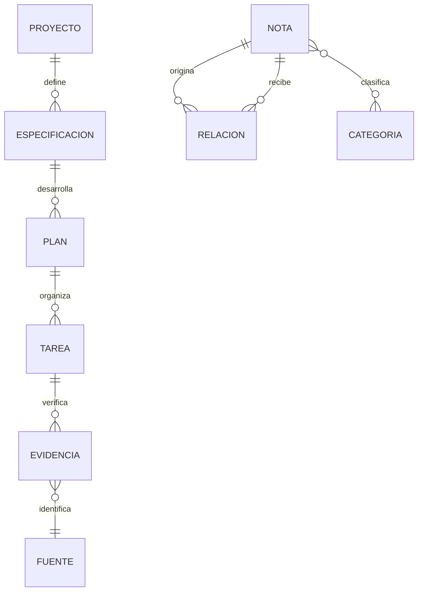

# Modelo del conocimiento documental

Es un modelo conceptual de archivos y enlaces. La bóveda no crea ni necesita una base de datos adicional. El modelo PostgreSQL de la aplicación se documenta por separado.
