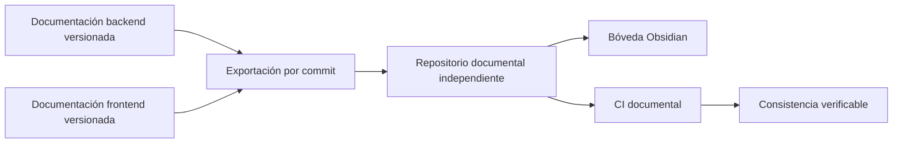

# Plan técnico

1. Exportar únicamente rutas documentales versionadas de los commits citados en PROCEDENCIA.md.
2. Mantener el segundo cerebro del backend en `specs/` y el SDD del frontend bajo `frontend/` para preservar enlaces y separar constituciones.
3. Añadir portada docente y configuración mínima compartida de Obsidian; no instalar plugins comunitarios.
4. Validar igualdad de plantillas, cercas Mermaid, destinos de enlaces y archivos Canvas.
5. Inicializar Git, publicar en un repositorio público propio y comprobar su workflow.
6. Enlazar el repositorio independiente desde los README del código.

## Decisiones

Se exporta desde Git para excluir estado ignorado y archivos locales. Las copias operativas de SDD en el código se conservan durante esta separación; eliminar sus plantillas rompería el flujo ya configurado. Este repositorio es la entrada documental docente y registra el corte importado, no una sincronización automática bidireccional.

Los verificadores son scripts Node.js sin dependencias. La configuración compartida de Obsidian incluye grupos de colores y plugins nativos; los archivos de sesión se ignoran.

