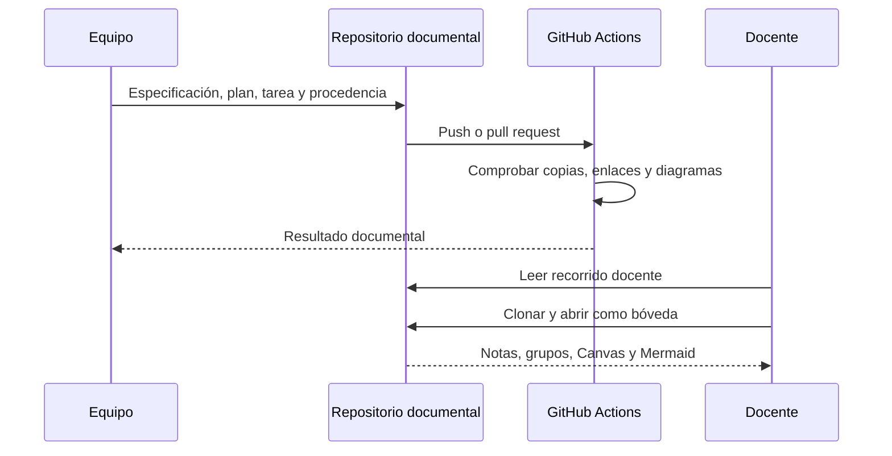

# Revisión y actualización documental

Antes de actualizar una evidencia, registrar qué commit y ejecución la produjeron. Una aprobación documental no reemplaza las pruebas del código ni acredita un despliegue.
