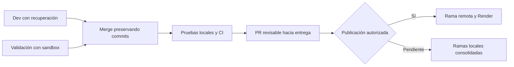

# Consolidación de recuperación y reparación aislada

Fecha: 2026-10-29. Solicitud del usuario: integrar la reparación Docker con las mejoras de recuperación de proyectos de las ramas de entrega. Se conserva la restricción anterior de validar antes de publicar en Render.

## Cambios y trazabilidad

| Requisito de integración | Implementación y evidencia |
|---|---|
| Conservar ambos historiales | Merge backend `39cb46a93b3c750100e09aab93950607aff357da`, padres `0f6ced2` y `a1ef8fd`; merge frontend `3b06f56e3bf2a213155865760649218c8d3b16d6`, padres `da32b57` y `b7bd553`. Sin squash ni rebase |
| Mantener recuperación | Conservados reclonado desde sourceUrl, registro único, invalidación del runtime y recuperación en UI |
| No autorizar reparación por recuperar archivos | `tests/server/project-reclone.test.mjs` exige 403 sin sandbox, fuente intacta y ninguna auditoría de reparación después de reclonar |
| Usar capacidad real del backend | Dos casos de `tests/file-forms.test.tsx` comprueban el botón de reparación para un proyecto importado recuperado con aislamiento disponible y no disponible |
| Verificar antes de publicar | [PR backend #5](https://github.com/LuisMI2005-sudo/ProyectoCertiIA/pull/5) hacia Dev; [PR frontend #1](https://github.com/SebhastianCampero-Collab/Frontend/pull/1) hacia dev |

La combinación no produjo conflictos de texto. Se verificó por ancestros Git que cada rama local de entrega contiene su rama remota anterior y la rama de validación. El historial del backend conserva aportes de LM, SebhastianCampero-Collab, Eduardo Quinteros y eduardoquinteross.

## Comprobación local

- Backend: `npm run check` y `npm run build` aprobados. Trece pruebas de recuperación, archivos y preflight aprobadas en tres suites.
- Frontend: `npm run check`, 125 pruebas en 14 archivos, build normal y build de plataforma aprobados. Se utilizaron los resultados de la ejecución final completada.
- El motor Docker local no respondió en esta sesión; no se afirma haber repetido localmente las siete pruebas Docker sobre el merge. Se ejecutan en el job CI correspondiente.

## Integración y límites

Las ramas locales Dev y dev se actualizaron por fast-forward a los merges; las ramas remotas de entrega permanecen sin modificar durante la preparación. Los PRs utilizan validate-isolated-repair como origen. Abrir un PR no configura un ejecutor cloud ni acredita generación real con Anthropic.

Consultar [validación anterior](validation.md) y [alcance](spec.md). La evidencia de CI de esta combinación corresponde a [backend](https://github.com/LuisMI2005-sudo/ProyectoCertiIA/actions/runs/40942257149) y [frontend](https://github.com/SebhastianCampero-Collab/Frontend/actions/runs/40942339109); comprobar su estado antes de publicar.
