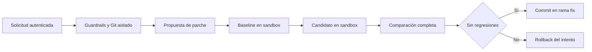

# Plan de ejecución

1. Comprobar Render y los requisitos del entorno aislado sin leer ni publicar valores de secretos.
2. Introducir un ejecutor de pruebas aislado configurable por el host; preservar los contratos del Test Runner y el comportamiento anterior para proyectos de confianza.
3. Preparar imágenes de ejecución con dependencias fijas, sin instalación de scripts del repositorio durante una auditoría.
4. Probar archivos de acceso al host, red, timeout y límites, además de baseline/candidato/rollback.
5. Validar en local y CI, sin modificar Render ni subir a las ramas de despliegue. Mantener las reparaciones bloqueadas cuando el proveedor de aislamiento no esté disponible.
6. Ejecutar una reparación con IA real si el usuario configura el proveedor y registrar evidencia concreta.

Un archivo Dockerfile no acredita aislamiento operativo: la prueba real requiere un motor disponible y una imagen construida. Un despliegue con la versión anterior tampoco acredita la publicación del perfil multitenant.

La validación usa ramas `validate-isolated-repair` en backend y frontend. El proveedor generativo requiere una clave configurada localmente, que nunca se copia a este repositorio documental.
