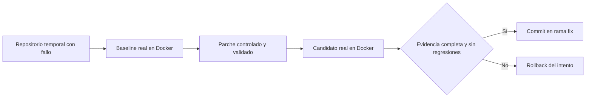

# Validación local de reparación aislada

Fecha: 2026-10-28. Alcance autorizado: local y CI primero; Render permanece sin cambios.

## Evidencia ejecutada

- Docker Desktop respondió con motor Linux; se construyó la imagen revisada con Node, Jest, TypeScript, pytest y pytest-json-report.
- Imagen local por ID inmutable: `sha256:5d26bb698f81a090257ac20b691a748777d6f4a5c5017098e5a2553685470da4`.
- `tests/test-runner/sandbox.test.mjs`: **7 pruebas aprobadas**, sin omisiones, en 76,651 segundos en la ejecución final. Incluye baseline fallido, candidato aprobado y commit real en un repositorio temporal; candidato incorrecto con rollback; pytest real; restricciones de escritura, credenciales, socket y red; timeout e identificación de imagen. El rollback exige evidencia completa de ambas ejecuciones fallidas.
- `npm run check` del backend: aprobado (TypeScript y ESLint).
- Frontend: 122 pruebas aprobadas en la verificación local precedente, con compilaciones normal y de plataforma. [CI del frontend aprobado](https://github.com/SebhastianCampero-Collab/Frontend/actions/runs/40775391697).

El primer CI del sandbox detectó una dependencia nativa opcional de Jest omitida en la imagen. Se eliminó esa omisión y se fijó la imagen base por digest; posteriormente pasaron las siete pruebas locales. Esto documenta un fallo corregido, no una ejecución inicial exitosa.

La siguiente ejecución CI detectó la ausencia de identidad Git durante el commit del candidato. Se configuró nombre/correo únicamente dentro del repositorio temporal. El [job Docker de la ejecución final](https://github.com/LuisMI2005-sudo/ProyectoCertiIA/actions/runs/40776863560/job/123128439757) aprobó las siete pruebas en Linux. La ejecución completa y sus resultados están disponibles en [GitHub Actions](https://github.com/LuisMI2005-sudo/ProyectoCertiIA/actions/runs/40776863560).

**Resultado final del backend: CI aprobado.** El job general completó 18 suites, 372 pruebas aprobadas y 5 omitidas, en 191,869 segundos. Las cinco omitidas son los casos Docker que se ejecutan en el job separado; allí se aprobaron 7 pruebas en 13,65 segundos (incluidos dos casos de configuración que también aparecen en el job general). No sumar ambos conteos como pruebas únicas. Se aprobaron además TypeScript, ESLint y las pruebas PostgreSQL de plataforma. El frontend y la validación documental también finalizaron en verde.

## Flujo comprobado



## Límites explícitos

Las propuestas de parche son controladas por la prueba: no se ha acreditado generación con Anthropic. Falta una clave configurada para ese ensayo. Docker reduce el acceso al host, pero estas pruebas no constituyen una certificación contra escapes del kernel. No se instala código de dependencias importadas; proyectos con dependencias adicionales requieren una imagen revisada.

El backend público Node Free actual no tiene configurado este ejecutor. La nueva política exige un sandbox operativo para reparaciones públicas y repositorios importados, pero estos cambios están en la rama de validación, no en Render. El despliegue distribuido y su infraestructura cloud quedan pendientes por decisión del usuario.

## Reproducción local

Desde el repositorio backend, con Node 24 y Docker Desktop en modo Linux:

```powershell
docker build -f sandbox/Dockerfile -t devguardian-tests:local .
$env:DEVGUARDIAN_SANDBOX_IMAGE_ID = docker image inspect --format '{{.Id}}' devguardian-tests:local
npm run build
node --experimental-vm-modules node_modules/jest/bin/jest.js --runInBand tests/test-runner/sandbox.test.mjs
```

Si Docker no está en PATH, configurar `DEVGUARDIAN_DOCKER_BINARY` con su ruta absoluta. No subir `.env` ni claves para reproducir esta prueba.
