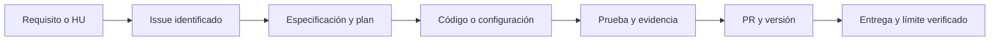

# Especificación de trazabilidad para la entrega final

Fecha: 2026-10-29. Solicitud: actualizar el backlog, retirar métricas y recorridos obsoletos y elegir el seguimiento que mejor cubra la rúbrica. El usuario solicita la mejor opción para la evaluación: issues reales enlazados a las HU, sin inventar una historia de desarrollo SDD anterior a su adopción.

## Requisitos y aceptación

- FR-001: conservar HU-01 a HU-43 y registrar por separado las nuevas capacidades. Cada HU tiene un estado verificable; una operación desplegada no acredita que el último PR esté publicado.
- FR-002: identificar versión backend, frontend, CI general y Docker; no sumar las pruebas duplicadas entre jobs ni atribuir cifras históricas al HEAD actual.
- FR-003: sustituir los recorridos de demos retiradas por importación, selector real, revisión, resultados y vistas avanzadas existentes. No prometer reparación pública sin sandbox.
- FR-004: cada HU debe enlazar issue, código/configuración, pruebas o evidencia aplicable, especificación/plan y PR conocido. La falta de evidencia se indica como pendiente.
- FR-005: los issues creados ahora son registros retrospectivos o de planificación actual; no se atribuyen al sprint original ni equivalen a revisión humana, venta, defensa o aprobación del docente.
- FR-006: mantener un backlog canónico en backend y una copia documental identificada en la bóveda independiente; comprobar estados, conteos, enlaces y correspondencia entre ambas copias.
- FR-007: vincular issues y PRs en ambos sentidos, indicando si la relación es documental, de controles de interfaz, integración actual o integración histórica de un archivo. Comprobar el archivo relacionado y el estado del PR. No inventar PRs originales cuando no hay evidencia ni introducir cierres automáticos para historias incompletas.

## Alcance y límites

Solo documentación y seguimiento en GitHub. No fusionar PRs, desplegar, cambiar fuentes de aplicación, implementar los pendientes ni marcar revisiones humanas como realizadas. Las historias anteriores conservan su aceptación; los cambios de estado se justifican con evidencia y límites actuales.

La matriz registra retrospectivamente las HU anteriores a Spec Kit. No afirma que las especificaciones originales existieran antes del código. Los enlaces al plan actual documentan la regularización de la trazabilidad, no la metodología histórica.

