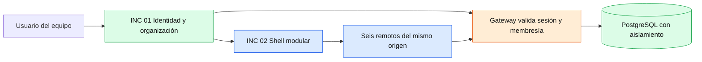

# Dos incrementos funcionales para la entrega final

**Definición del equipo propuesta en esta conversación: 29/10/2026.** Se seleccionan exactamente dos incrementos sobre la entrega técnica del 20/10: **INC-01 Gestión segura de organizaciones y accesos** e **INC-02 Espacio de trabajo modular con microfrontends**. No se afirma que el docente ya los haya aceptado ni que esta especificación existiera antes de implementar el código.

Esta definición responde a la condición de la planilla final de añadir dos módulos si el proyecto ya se había terminado en el segundo parcial. La conformidad con el alcance académico se obtiene presentando el antes/después, la utilidad y la evidencia; no contando carpetas o procesos.

## Base y diferencia verificable

| Elemento | Base de comparación del 20/10/2026 | Implementación posterior |
|---|---|---|
| Backend | [f9438ef](https://github.com/LuisMI2005-sudo/ProyectoCertiIA/commit/f9438efecb32df9175819fd6f0667b91b1529c42), demo cloud y motor/API/MCP existentes; no contiene src/platform/ | [d6af0f7](https://github.com/LuisMI2005-sudo/ProyectoCertiIA/commit/d6af0f7c0d67a5d7a0d9eb453ba77a3df82f10f6) del 28/10 incorpora identidad/plataforma. Código de integración referenciado: [39cb46a](https://github.com/LuisMI2005-sudo/ProyectoCertiIA/commit/39cb46a93b3c750100e09aab93950607aff357da) |
| Frontend | [f83d928](https://github.com/SebhastianCampero-Collab/Frontend/commit/f83d9286b2d1c5ccdfb51056a6a345b62449c611), dashboard React; no contiene src/platform/ ni src/microfrontends/ | [22d4b2d](https://github.com/SebhastianCampero-Collab/Frontend/commit/22d4b2d82c5dca9ca798cc6647ba9f2feca69965) del 28/10 incorpora Shell/remotos. Código de integración referenciado: [3b06f56](https://github.com/SebhastianCampero-Collab/Frontend/commit/3b06f56e3bf2a213155865760649218c8d3b16d6) |

La base se eligió por sus commits de entrega fechados el 20/10, no por una firma de aceptación del docente. Si el curso reconoce otro corte del segundo parcial, debe sustituirse la referencia y revisar la diferencia, sin alterar el historial.

## INC-01 Gestión segura de organizaciones y accesos

**Usuario y valor:** como responsable de un equipo, quiero iniciar sesión, elegir una organización autorizada y consultar solo sus proyectos y auditorías, para trabajar en una plataforma compartida sin mezclar información de otros equipos.

**Antes:** el modo de entrega anterior no ofrecía el perfil de identidad, membresías y RLS de platform. Su token opcional de API y la protección de rutas no equivalen a aislamiento por organización.

**Después:** el perfil local platform autentica sesiones, valida membresías en el servidor, aplica roles owner/member/viewer y aísla registros mediante contexto validado y PostgreSQL RLS. El cambio de organización selecciona un espacio distinto; no se confía en que el navegador simplemente oculte una lista.

| Criterio | Resultado exigido | Evidencia disponible y condición manual |
|---|---|---|
| INC-01-AC01 | Credenciales válidas permiten iniciar sesión; solicitudes protegidas sin sesión reciben 401 | Login real en preparación de integración PostgreSQL y prueba de acceso sin sesión. Mostrarlo en la demo final |
| INC-01-AC02 | Solo se permite seleccionar organizaciones con membresía; un identificador no autorizado recibe 403 | Prueba HTTP de membresía/tenant falsificado. Demostración técnica de respuesta pendiente de registrar para la defensa |
| INC-01-AC03 | Un proyecto creado en A no aparece en B ni se puede consultar su archivo/historial desde B | Prueba real con repositorio Git, consulta HTTP y RLS. En la demo mostrar ambos listados con IDs distintos |
| INC-01-AC04 | Un viewer puede leer, pero no realizar operaciones de escritura ni invocar herramientas no autorizadas | Prueba de viewer en integración PostgreSQL y requireWrite. No se presenta el bloqueo visual como única seguridad |
| INC-01-AC05 | El contexto no se filtra entre transacciones y el rol runtime no tiene bypassRLS/superuser | Pruebas SQL reales de roles, escrituras sin contexto, contexto cruzado y limpieza. Evidencia técnica, no una animación de UI |
| INC-01-AC06 | Cerrar sesión revoca el token; cambiar organización desmonta la vista y reinicia contexto/proyecto | Revocación HTTP real y prueba de Shell con cliente/loader controlados. Repetir recorrido visible en el ensayo final |

**Principal:** [HU-44 / issue #49](https://github.com/LuisMI2005-sudo/ProyectoCertiIA/issues/49). **Soporte, no tercer incremento:** [HU-45 / issue #50](https://github.com/LuisMI2005-sudo/ProyectoCertiIA/issues/50) para las fronteras de servicio, gateway y datos privados. [HU-22](https://github.com/LuisMI2005-sudo/ProyectoCertiIA/issues/27) y [HU-39](https://github.com/LuisMI2005-sudo/ProyectoCertiIA/issues/44) conservan la revisión y defensa humanas.

**Fuera de alcance del cierre local:** OIDC/SSO, recuperación de cuentas, facturación, políticas administrables por tenant, migración de datos históricos y operación empresarial multitenant en Render. No se reutilizan credenciales ni datos productivos para el ensayo.

## INC-02 Espacio de trabajo modular con microfrontends

**Usuario y valor:** como usuario autenticado, quiero trabajar en una Shell que compone proyectos, revisión, resultados, seguridad, subagentes y sandbox MCP mediante módulos con contratos explícitos, para mantener una navegación coherente y poder actualizar un módulo sin reconstruir todos los remotos.

**Antes:** el dashboard existía, pero no la Shell de platform, el manifiesto de remotos ni su contrato de montaje. Tener varias pantallas React no acreditaba por sí solo microfrontends.

**Después:** Shell con sesión/organización, seis artefactos ESM cargados desde un manifiesto del mismo origen y contrato versionado mount/update/unmount. Hay limpieza al cambiar contexto, manejo visible de fallo de carga y posibilidad de compilar un remoto concreto.

| Criterio | Resultado exigido | Evidencia disponible y condición manual |
|---|---|---|
| INC-02-AC01 | El build genera Shell, manifiesto versión 1 y seis entradas de remoto: projects, review, results, security, subagents y mcp | CI build:platform y script de construcción. Se inspeccionó también un manifiesto local con seis rutas hash existentes; esto no sustituye su carga real en navegador |
| INC-02-AC02 | Navegación monta el módulo correspondiente, con sesión, tenant y rol bajo un contrato común | Shell, contratos y adaptadores implementados; la prueba unitaria usa loader simulado. Recorrido visible de los seis remotos pendiente de registrar sobre la versión final |
| INC-02-AC03 | Cambiar organización desmonta el módulo anterior y no conserva el proyecto seleccionado | Prueba unitaria de Shell y ciclo de vida; integra con la seguridad de INC-01. No se cuenta como un tercer módulo |
| INC-02-AC04 | Un remoto que termina de cargar después de salir de la vista no se monta | Prueba de RemoteView con promesa controlada; el montaje tardío debe permanecer cancelado |
| INC-02-AC05 | La carga fallida presenta un error y permite Reintentar módulo, sin inventar resultados | Manejo implementado en RemoteView. Falta ejecutar/registrar el caso manual de un recurso bloqueado en el ensayo final |
| INC-02-AC06 | Compilar solo review conserva las entradas de los otros remotos; el loader rechaza versiones/orígenes no autorizados | Script y validaciones implementados. CI acredita el build completo, no una prueba explícita de reconstrucción independiente ni todos los fallos del loader; comprobarlos en el protocolo de aceptación |

**Principal:** [HU-46 / issue #51](https://github.com/LuisMI2005-sudo/ProyectoCertiIA/issues/51). **Soporte:** [HU-31 / issue #36](https://github.com/LuisMI2005-sudo/ProyectoCertiIA/issues/36) para las funciones existentes de los paneles. Los seis remotos son partes de este incremento, no seis módulos extra de la rúbrica.

**Fuera de alcance:** desplegar los seis remotos en proveedores/orígenes diferentes, ejecución de plugins externos o demostrar mejoras de rendimiento no medidas. La implementación actual sirve artefactos independientes en un mismo origen; no se afirma que use Module Federation.

## Integración de los dos incrementos

La infraestructura distribuida es soporte de ambos incrementos. El motor AST, Git, pruebas, MCP y guardrails conserva su autoridad. Esta selección no autoriza fusionar PRs, desplegar, habilitar reparaciones cloud ni afirmar aceptación docente. Los incrementos están implementados con evidencia local/CI; la aceptación de la demo final sigue pendiente.

Ver [plan y tareas](plan.md), [evidencia](evidence.md) y [guion de demostración](demo.md).
