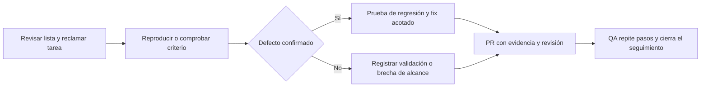

# Registro único de bugs y pendientes de entrega

Fecha: 29/10/2026. Solicitud: cada fix debe tener HU/issue, reproducción, resultado esperado y prueba que lo verifica, para coordinar el trabajo del equipo sin duplicarlo.

## Alcance y aceptación

- FR-QA-001: publicar una única lista canónica de trabajo en CONTROL_DE_FIXES.md de esta bóveda. Los repositorios de aplicación solo enlazan ese documento.
- FR-QA-002: cada entrada contiene ID estable, tipo, prioridad, HU/issue, entorno, condición observada, pasos de comprobación, resultado esperado, verificación de cierre, evidencia y responsable.
- FR-QA-003: usar los 18 issues abiertos existentes como seguimiento y añadir dos casos de aceptación de incrementos dentro del issue de demo; no duplicar las HU ni inventar defectos reproducidos.
- FR-QA-004: separar un bug confirmado de una capacidad incompleta, cobertura pendiente, demostración o revisión humana. Al crear esta lista no se ejecutan nuevos ensayos de producto ni se declara un fallo nuevo.
- FR-QA-005: acordar responsable antes de editar; registrar rama/PR y evidencia de prueba antes de cerrar. No inventar asignaciones, fechas, revisión humana o resultados.
- FR-QA-006: crear un issue coordinador como índice de los issues existentes, no como reemplazo de sus criterios. La lista no autoriza fusión, deploy, gastos cloud ni cambios de seguridad.

## Fuente y límites

Fuente de estado: inventario de las 51 HU y consulta de los 18 issues abiertos del backend al corte. No se cambia el estado de ninguna HU por incluirla aquí. La prioridad describe orden de cierre, no severidad de un defecto. El ensayo humano y los arreglos de compañeros pueden cambiar la lista después del corte; actualizarla con evidencia, sin reescribir los resultados históricos.

## Comprobación del registro

Se publicaron 20 casillas en el issue coordinador #57 y se enlazaron los 18 issues existentes, preservando estado y responsables. Las dos aceptaciones de incrementos se coordinaron dentro de HU-37; no se duplicaron HU-44/HU-46 ni se reabrieron sus cierres técnicos.

`npm run qa:render` genera la lista desde cases.json. `npm run check` aprobó SDD, bóveda, trazabilidad y `qa:check`: 143 Markdown, tres Canvas, 67 Mermaid, 20 grupos y 20 casos únicos con las 18 HU abiertas cubiertas. Los chequeos SDD y de diferencias del backend/frontend también aprobaron. Son verificaciones documentales, no nuevos ensayos de los casos QA ni una confirmación de ausencia de bugs en la aplicación.

