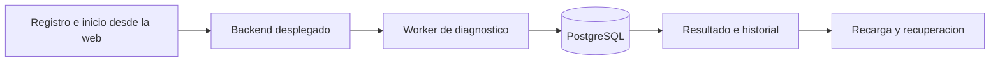

# Recorrido de la versión desplegada

Solicitud del usuario del 29/10/2026: demostrar registro de proyecto, diagnóstico, resultado e historial persistido, incluida recarga y error controlado, e identificar el commit servido por el hosting.

## Criterios y resultado

- [x] E2E-01 Identificar los commits Live de backend/frontend mediante el panel del hosting.
- [x] E2E-02 Importar desde la web un repositorio público propio de ensayo, sin instalar dependencias ni ejecutar scripts.
- [x] E2E-03 Solicitar diagnóstico de un archivo real y ver el hallazgo esperado.
- [x] E2E-04 Recargar la página y recuperar el mismo resultado desde el historial persistido.
- [x] E2E-05 Solicitar un archivo inexistente y comprobar un error comprensible, sin declararlo análisis limpio.
- [x] E2E-06 Recargar nuevamente, comprobar persistencia de ambos intentos y recuperar el resultado anterior sin ejecutar otro diagnóstico.
- [x] E2E-07 Guardar IDs, estados y capturas sin credenciales, junto con los límites de lo demostrado.

## Método ejecutado

Se usó la web pública real con el navegador integrado. Se consultó Render en modo de lectura y la API pública para correlacionar exclusivamente las auditorías creadas por este ensayo. Se restauró la selección válida al terminar. El acta distingue estados de auditoría del estado del diagnóstico. No hubo modificaciones de código del producto, cambios de configuración de Render, reparaciones ni generación comercial de IA.

## Evidencia y pendientes

Ver [acta del recorrido](ACTA.md). QA-003 acredita este recorrido técnico; la revisión humana sigue separada. QA-002 acredita el commit Live y el disparador Auto-Deploy observado; no se ensayó un pipeline deliberadamente fallido ni recuperación de un deploy fallido. No se cierran automáticamente las HU completas ni se cambian sus criterios para ocultar pendientes.
