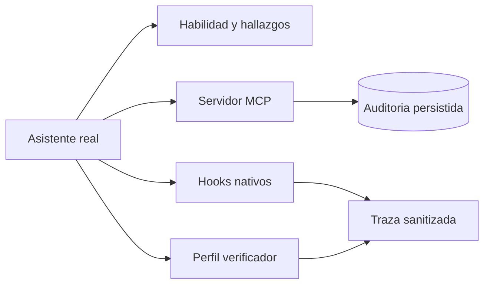

# Demostración real del asistente

Solicitud del usuario del 29/10/2026: mostrar funcionando una habilidad, MCP, hooks y subagentes, con ejecución y traza. Los archivos de configuración no constituyen aceptación por sí solos.

## Criterios

- [x] AS-01 Aplicar `speckit-analyze` a artefactos existentes y entregar hallazgos concretos sin modificarlos.
- [x] AS-02 Ejecutar herramientas MCP desde el asistente nativo y registrar resultados sin contenido fuente ni secretos.
- [x] AS-03 Aprobar los hooks mediante el flujo normal, con autorización expresa, y obtener eventos nativos reales.
- [x] AS-04 Cargar el perfil nativo `verificador`, observar inicio y fin, y registrar el resultado y sus límites. Ejecutar además una verificación independiente mediante un subagente del chat.
- [x] AS-05 Conservar una traza sanitizada y distinguir hooks nativos, controles MCP del motor y rechazos del runtime.
- [x] AS-06 Completar una edición permitida con verificación posterior y demostrar aisladamente la interceptación de una edición protegida. Ensayo inicial bloqueado por Windows legacy; repetición completa del 30/10 con MXC y corrección autorizada del wrapper documentada en [acta posterior](../013-native-hook-acceptance/ACTA.md).

## Método y alcance

Sesiones locales de Codex CLI 0.162.1 sobre backend `15eedc0c11a62535add7efc9fd3ecb038e5c8ad6`. La habilidad analiza `specs/001-sdd-foundation`; las llamadas MCP usan el servidor desplegado y el proyecto público de ensayo ya registrado. La confianza se aprobó en `/hooks` después de que el usuario respondió «Autorizo». No se modificaron los comandos, perfiles ni políticas del proyecto para lograr la ejecución.

Los fallos del runtime se conservan como resultados. Este ensayo no acredita reparaciones ni revisión docente; tampoco convierte la verificación estructural en revisión visual de Obsidian. Ver [acta y resultados](ACTA.md).

